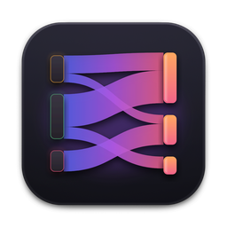
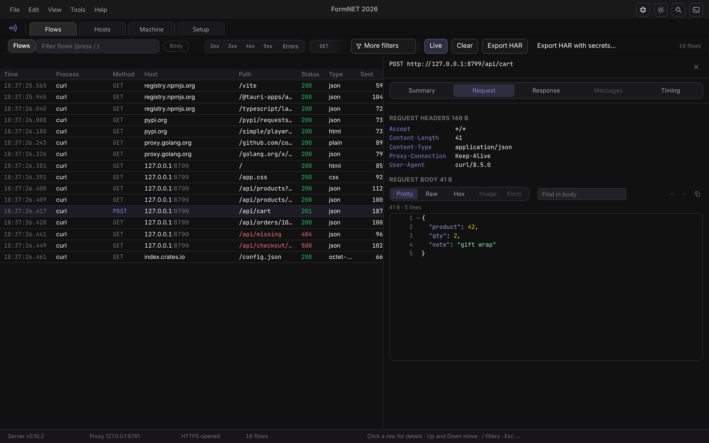
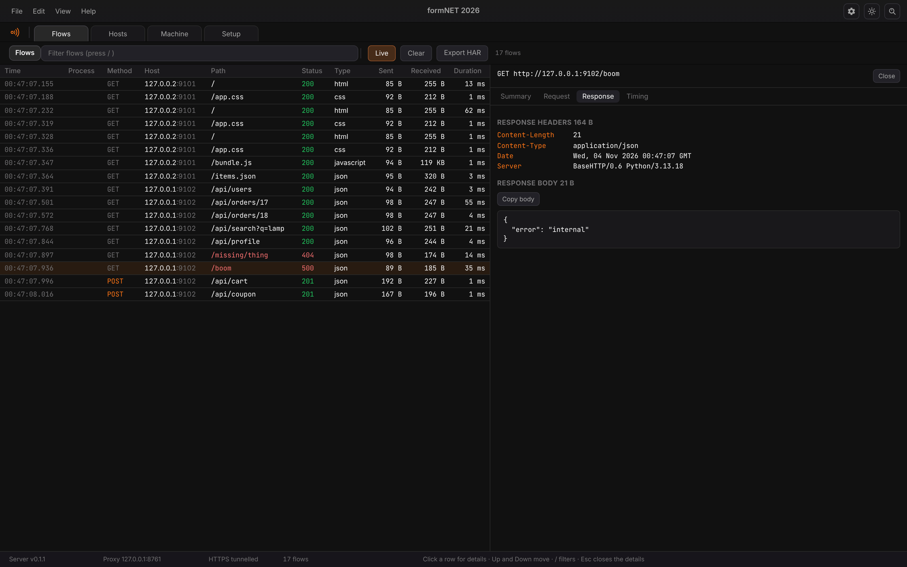
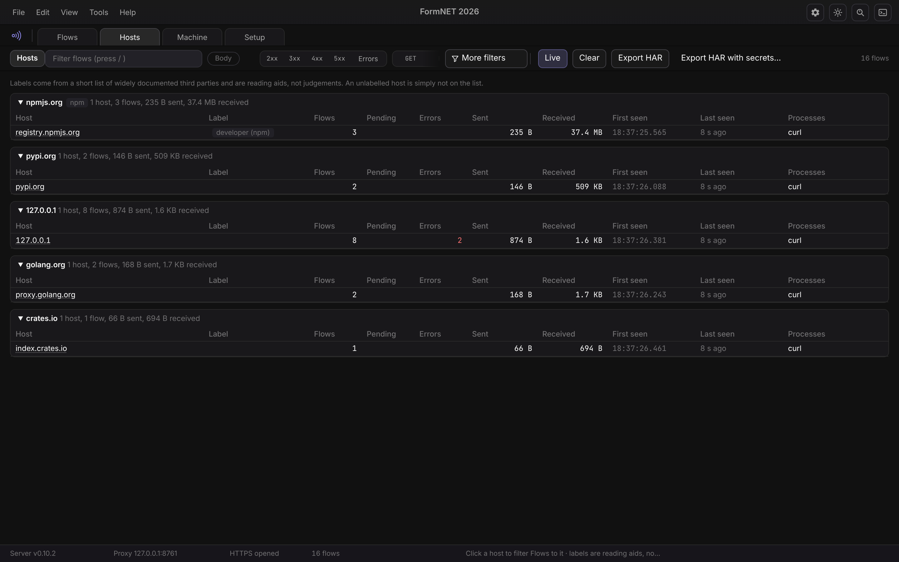

<p align="center">
  
</p>

<h1 align="center">FormNET</h1>

<p align="center">
  <b>Network inspection; the network tab for your whole computer.</b><br>
  Flows, hosts and every open connection with the process behind it,<br>
  in one window with no account. Local only, and yours.
</p>

<p align="center">
  
  
  
  
  
  
</p>

<p align="center">
  <a href="https://formai.studio/"><b>Download FormNET on formai.studio</b></a> ·
  <a href="#run-it-from-source">Run it from source</a>
</p>

<br>

<p align="center">
  
  <br>
  <sub>Live flows through the proxy, with the selected request's headers and body.</sub>
</p>

<p align="center">
  <a href="#features">Features</a> ·
  <a href="#everything-in-the-box">In the box</a> ·
  <a href="#built-for-agents">Agents</a> ·
  <a href="#under-the-hood">Under the hood</a> ·
  <a href="#download">Download</a> ·
  <a href="#run-it-from-source">Run from source</a>
</p>

<br>

<table>
  <tr>
    <td width="25%" valign="top">
      <h3>Whole machine</h3>
      Not one page and not one proxy: every connection the computer holds, with the process that owns it.
    </td>
    <td width="25%" valign="top">
      <h3>Full detail</h3>
      Headers, bodies up to a limit, sizes, timings and the TLS that was negotiated, for each request.
    </td>
    <td width="25%" valign="top">
      <h3>Nothing leaves</h3>
      Both listeners bind loopback only unless you let a phone or another computer use the proxy, and recordings stay in memory until you save or export them.
    </td>
    <td width="25%" valign="top">
      <h3>Agent-ready</h3>
      Agents read the same recording through <code>formnet mcp</code>, an MCP server with 10 tools; scripts use a token-guarded local API, and <code>formnet snapshot</code> prints the connection table as JSON.
    </td>
  </tr>
</table>

<br>

## Features

<table>
  <tr>
    <td width="50%" valign="top">
      
      <br><sub>A 500 response with its headers and body.</sub>
      <h3>Every request, in full</h3>
      Click a flow to read what was sent and what came back. Opaque tunnels are still counted by host and bytes.
    </td>
    <td width="50%" valign="top">
      
      <br><sub>Per-host totals, grouped by domain.</sub>
      <h3>Who it talks to</h3>
      Requests, errors and bytes each way per host. Widely documented third parties get a reading-aid label, never a verdict.
    </td>
  </tr>
  <tr>
    <td width="50%" valign="top">
      <h3>Change what passes</h3>
      Rewrite headers, addresses, status or bodies, answer from a local file, block a host, pause a request to edit it, resend any request, or slow everything to 3G. On macOS and Windows FormNET can point the system proxy at itself while it runs.
    </td>
    <td width="50%" valign="top">
      <h3>Find it, keep it</h3>
      Filter by status, method, type, size, time, process or host, or type <code>status-code:404</code> as in a browser's tools; search inside bodies; read JSON, HTML, images and WebSocket messages; save a session, import a HAR, copy everything as cURL.
    </td>
  </tr>
</table>

## Everything in the box

<table>
  <tr>
    <td width="33%" valign="top">
      <h4>4 views</h4>
      Flows · Hosts · Machine · Setup
    </td>
    <td width="33%" valign="top">
      <h4>Proxy</h4>
      Plain HTTP forwarding · CONNECT tunnels · TLS interception with a local root · HTTP/2 and gRPC · WebSocket messages · Passthrough patterns · Rules, breakpoints and throttling · System proxy on macOS and Windows · Upstream proxy · Capture from other devices
    </td>
    <td width="33%" valign="top">
      <h4>Formats</h4>
      Exports: HAR 1.2 and sessions of any filtered view · Imports: HAR 1.2 and sessions · Copy All as cURL: sh, PowerShell, cmd · Machine snapshot: JSON
    </td>
  </tr>
</table>

## Built for agents

```sh
./bin/formnet mcp        # an MCP server on stdio for agents such as Claude Code
./bin/formnet snapshot   # the machine's connection table once, as JSON
./bin/formnet ca         # root certificate path, fingerprint and trust state
curl -H "Authorization: Bearer $(cat ~/formnet/token)" http://127.0.0.1:8760/api/flows   # recorded flows
```

Also `/api/flows/{id}`, `/api/hosts`, `/api/machine`, `/api/export/har` and `/api/stream`. See [`AGENTS.md`](AGENTS.md).

`formnet mcp` reads the running FormNET and starts nothing. Its 10 tools: six read flows, hosts, the machine table, the proxy and the root certificate; one exports a HAR into FormNET's own exports folder; three change things (clear the recording, the HTTPS choice, the passthrough list) and ask you first. Passwords, tokens and cookies read `[redacted]` in everything an agent sees unless you approve otherwise. Register it as a stdio server, for example in a project's `.mcp.json`: `{"mcpServers": {"formnet": {"command": "formnet", "args": ["mcp"]}}}`. The skill pack `formnet-inspector` (in `.claude/skills/`, mirrored in `.agents/skills/`) teaches an agent to route a program through the proxy, trust the root, read what it sent and export a HAR.

## Under the hood

- **One binary:** a Go server with the web client embedded, plus a Tauri 2 window around the same binary for the desktop app.
- **Loopback by default:** the API and the page answer on loopback only, always; the proxy also listens on the network only while "capture from other devices" is on, for the addresses you allow. The proxy never connects to loopback through a host name.
- **Local root:** the certificate is made on first run, its private key never leaves `~/formnet`, and HTTPS is opened only once you trust it.
- **Updates:** through FormPortal only. FormNET has no updater of its own and never checks for one.
- **Tested:** 82 Go tests and a Playwright window smoke in CI.

## Download

| Platform | Download | Release |
|---|---|---|
| macOS | [Download FormNET for macOS](https://formai.studio/get/formnet/macos) | [FormNET releases on FormCompiler](https://github.com/nodemode-dev/formcompiler/releases?q=formNET-v&expanded=true) |
| Windows | [Download FormNET for Windows](https://formai.studio/get/formnet/windows) | [FormNET releases on FormCompiler](https://github.com/nodemode-dev/formcompiler/releases?q=formNET-v&expanded=true) |
| Linux | [Download FormNET for Linux](https://formai.studio/get/formnet/linux) | [FormNET releases on FormCompiler](https://github.com/nodemode-dev/formcompiler/releases?q=formNET-v&expanded=true) |

All FormNET builds are compiled and released from [FormCompiler](https://github.com/nodemode-dev/formcompiler); this repo holds the source. Updates come through FormPortal, the family's app for installing and updating its apps.

## Run it from source

**Requires:** Go 1.26 and Node.js 22.

```sh
git clone git@github.com:nodemode-dev/formNET.git
cd formNET
make build          # builds the client and bin/formnet
./bin/formnet       # client and proxy; prints the address with this run's token
./bin/formnet open  # opens that address in your browser
```

For client development, `cd web && npm ci && npm run dev` serves the client on http://localhost:5176, proxied to a running formnet.

Then point a program at the proxy, for example `curl -x http://127.0.0.1:8761 http://example.com/`. Until the computer trusts the root, HTTPS is tunnelled and counted but not opened; `./bin/formnet ca trust` prints the command that trusts it for your user only.

The client and API listen on 127.0.0.1:8760 and the proxy on 127.0.0.1:8761 (loopback only, unless capture from other devices is on, which adds the proxy alone on the addresses you allow; the client needs this run's session token). Settings are `FORMNET_*` environment variables, such as `FORMNET_DATA`, `FORMNET_PASSTHROUGH` and `FORMNET_INTERCEPT`; `./bin/formnet help` lists them all.

> [!IMPORTANT]
> **Status:** early (v0.1). The desktop window source has not been compiled yet, and the process column in Flows is filled only where the platform reports it.

**Contributing:** branch from `main`, keep changes to source here, and leave packaging and releases to formcompiler. See [`AGENTS.md`](AGENTS.md).

## Repository

`cmd/formnet/` and `internal/` (command, proxy, flow store, CA, machine view, server, rules, system proxy, MCP server, terminal engine) · `web/` (client) · `src-tauri/` (desktop window) · `.claude/skills/` (the skill pack).

Agents: [`CLAUDE.md`](CLAUDE.md), [`AGENTS.md`](AGENTS.md)

---

## Maintainers

| Maintainer | Role |
|---|---|
| [@nodemode-ai](https://github.com/nodemode-ai) (Mackin) | Owner |
| [@gbarnai](https://github.com/gbarnai) (Greg) | Co-Owner |

Code owners are set in [`.github/CODEOWNERS`](.github/CODEOWNERS).

## License

FormNET is licensed under the Apache License 2.0 ([`LICENSE`](LICENSE), SPDX `Apache-2.0`). Copyright 2026 NodeAgentc, Inc.
